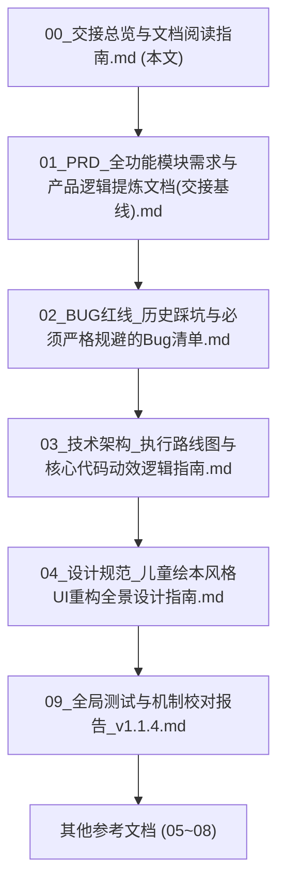

# 🐾 《班级电子宠物 (ClassPet)》v1.1.4 交接总览与文档阅读指南

欢迎接手《班级电子宠物 (ClassPet)》项目！本项目是一套专为中小学智慧课堂设计的交互式班级成长激励与电子宠物养成桌面软件。

为了让你在最短时间内全面吃透产品逻辑、避免重复踩坑并顺畅接手后续迭代，所有核心驱动文档已集中规整至本 `docs/` 目录。建议按照以下**推荐阅读顺序**逐一阅览：

---

> [!IMPORTANT]
> ### ⚠️ 研发交接特别声明（接手人员必读）：文档不代表代码实际效果
> 本项目在实战研发与实际课堂交付过程中，历经数轮高频功能迭代、多轮用户体验重构与甲方现场需求变更。因此交接成员请务必牢记：
> 1. **代码与自动化测试是系统的唯一最终真理（Source of Truth）**：本 `docs/` 目录中的系列文档主要用于帮助您理解项目的业务背景、产品演进脉络与技术避坑思路。**文档中记载的早期设计与部分描述绝不代表当前代码的实际运行效果**。
> 2. **一切功能逻辑与业务规则以最新 v1.1.4 源码为准**：当前生产代码（特别是核心状态调度引擎 `classpet_core.js`、教师端 `teacher_panel_touch_pro.html`、大屏端 `display_bigscreen_touch_pro.html` 以及 `tests/` 中的全套自动化测试套件）已全部通过 181 项真机断言与全量机制校对。
> 3. **若文档叙述与代码实现存在任何出入，必须严格以最新代码逻辑及测试用例为最终准绳！**

---

## 🗺️ 推荐阅读顺序与文档索引



### 1. 📖 第一站：产品逻辑与业务基线
* **文件名**：[`01_PRD_全功能模块需求与产品逻辑提炼文档(交接基线).md`](./01_PRD_全功能模块需求与产品逻辑提炼文档(交接基线).md)
* **核心内容**：系统的完整 PRD。详细定义了教师端、学生大屏端两大视窗；语文/数学/英语三大学科解锁链（语文满级后二选一）；8 大治愈系 Q 版宠物、成长 5 阶段（蛋 ➔ 幼宠 ➔ 少年 ➔ 进阶 ➔ 青年 ➔ 究极神兽）；积分规则与撤销流水机制。

---

### 2. ⚠️ 第二站：避坑指南与质量红线
* **文件名**：[`02_BUG红线_历史踩坑与必须严格规避的Bug清单.md`](./02_BUG红线_历史踩坑与必须严格规避的Bug清单.md)
* **核心内容**：团队历经数轮真机攻坚沉淀的**绝不可触碰的高压红线**：
  1. 重启后加分进度条假死与 SQLite 单调合并原则；
  2. Windows Excel 导出 CSV 的 GBK/ANSI 乱码修复与异常诊断弹窗；
  3. 语文蛋放行赋分与进阶学科未解锁硬核拦截；
  4. 负分扣分等级/视觉绝不退化不变量；
  5. 避免事件重复绑定与 DOM 穿透。

---

### 3. 🛠️ 第三站：技术架构与核心代码指南
* **文件名**：[`03_技术架构_执行路线图与核心代码动效逻辑指南.md`](./03_技术架构_执行路线图与核心代码动效逻辑指南.md)
* **核心内容**：系统技术栈（Electron + HTML5 Canvas + SQLite3 + 原生 JavaScript 状态总线），双窗口跨屏通信架构（BroadcastChannel + IPC），大屏 3 种视图布局（全班平铺/按组排布/小组PK），以及屏幕下沉 260px、随机点名弹窗、全屏多彩烟花引擎等核心动效逻辑。

---

### 4. 🎨 第四站：美术与视觉设计规范
* **文件名**：[`04_设计规范_儿童绘本风格UI重构全景设计指南.md`](./04_设计规范_儿童绘本风格UI重构全景设计指南.md)
* **核心内容**：治愈系 Q 版儿童绘本风格标准、配色规范（暖阳、晴空、森林、紫藤 4 款主题芯片）、8 大神兽资产名录、视觉演进阶段标准、提示词与素材规格。

---

### 5. 🧪 第五站：自动化测试与系统验收
* **文件名**：[`09_全局测试与机制校对报告_v1.1.4.md`](./09_全局测试与机制校对报告_v1.1.4.md)
* **核心内容**：v1.1.4 版本的 10 维度全局机制校对成果与全套 181 项自动化测试 100% 通过记录。仓库中附带全套测试脚本，接手后可随时一键运行复检。

---

### 6. 📚 辅助背景资料
* **[`05_决策全景_系统全会话记录与决策全过程整理文档.md`](./05_决策全景_系统全会话记录与决策全过程整理文档.md)**：项目演进的全程会话脉络与每次功能迭代背后的设计初衷。
* **[`06_AI协作_重构任务交付提示词(Codex与AI专用).md`](./06_AI协作_重构任务交付提示词(Codex与AI专用).md)**：使用 AI 结对编程时的提示词模板与上下文指引。
* **[`07_历史审查_代码与资产全文件夹审查报告.md`](./07_历史审查_代码与资产全文件夹审查报告.md)**：历史资产梳理与结构审阅备忘。
* **[`08_原始需求_甲方意见/`](./08_原始需求_甲方意见/)**：甲方客户最初提供的原始需求文档与会议沟通录音。

---

## 💻 快速运行与验证指南

1. **安装依赖**：
   ```bash
   cd electron-app
   npm install
   ```
2. **本地开发运行**：
   ```bash
   npm start
   ```
3. **运行全量自动化测试**：
   ```bash
   npm test
   # 或运行 10 维度大师测试
   npx electron tests/test_global_master_verification.js
   ```
4. **打包 Windows 生产发布版**：
   ```bash
   npm run dist:win
   ```
   输出安装包将生成至 `release/` 目录。
