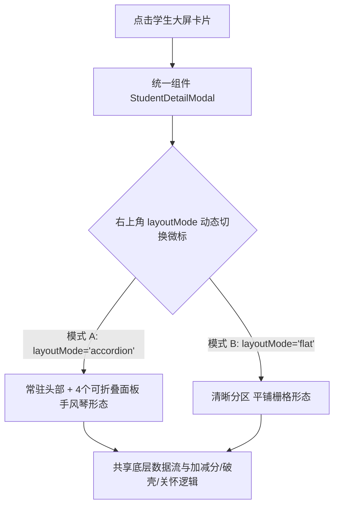
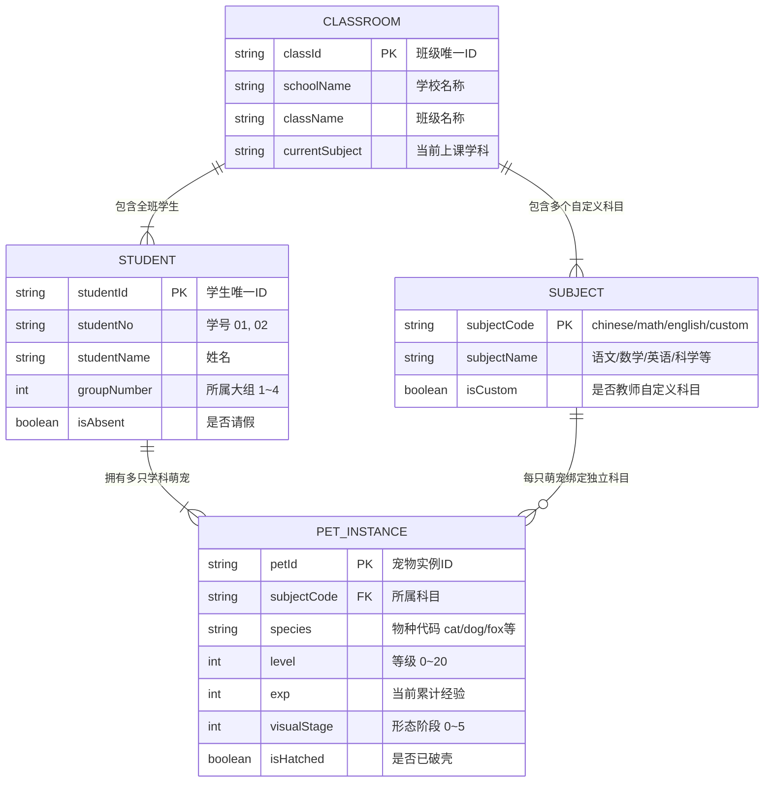

# 班级电子宠物管理系统 · 全功能模块需求与产品逻辑提炼文档 (PRD交接基线)

> **文档性质**：项目全局重构与工具交接专用基线文档（PRD）  
> **文档版本**：V2.0-Rebuild-Draft  
> **交付目标**：供 Codex、中转站后端开发、新框架前端以及后续协作团队无缝交接使用。  
> **核心原则**：
> 1. **纯净功能与逻辑（零视觉样式）**：彻底剔除被上级/工作室全盘否定的所有 UI 视觉设计描述（包括但不限于配色、阴影、Neo-Brutalism黑边框、插画、卡片拟物装饰等），只保留严谨的功能模块、数据字段、状态流转、业务规则与交互逻辑。
> 2. **全量信息深度提炼**：深度综合工作区历史对话、历次现场录音校对（含《甲方意见汇总》与《2026-09-18 录音现场纠偏》）、原有代码实现及负责人最新定调的 3 大重构要点。

---

## 目录索引

- [一、全局重构定位与架构原则](#一全局重构定位与架构原则)
- [二、用户认证、班级账号与主控制大厅](#二用户认证班级账号与主控制大厅)
- [三、学生大屏（Classroom Display）核心功能模块](#三学生大屏classroom-display核心功能模块)
  - [3.1 学生大屏主看板与卡片信息架构](#31-学生大屏主看板与卡片信息架构)
  - [3.2 学生卡片详情弹窗：折叠版 vs 不折叠版评估设计（核心点1）](#32-学生卡片详情弹窗折叠版-vs-不折叠版评估设计核心点1)
  - [3.3 悬浮圆圈快捷菜单机制（全量二级/三级圆圈清单与逻辑）](#33-悬浮圆圈快捷菜单机制全量二级三级圆圈清单与逻辑)
  - [3.4 破壳、认领与阶段进化（原地闭环 + C位高光仪式）](#34-破壳认领与阶段进化原地闭环--c位高光仪式)
  - [3.5 课堂教学辅助能力（随机点名、屏幕下沉、PK榜双模态）](#35-课堂教学辅助能力随机点名屏幕下沉pk榜双模态)
- [四、教师操作台（Teacher Workstation）全功能模块](#四教师操作台teacher-workstation全功能模块)
  - [4.1 核心原则：“指哪打哪”秒级赋分引擎](#41-核心原则指哪打哪秒级赋分引擎)
  - [4.2 学生管理与花名册智能导入（Excel/批量文本/自动补齐学号）](#42-学生管理与花名册智能导入excel批量文本自动补齐学号)
  - [4.3 小组管理与考勤免打扰置灰（防误加分）](#43-小组管理与考勤免打扰置灰防误加分)
  - [4.4 课堂评价行为规则库维护](#44-课堂评价行为规则库维护)
  - [4.5 经验值成长曲线与等级阈值设置（极简化预设与回退基准）](#45-经验值成长曲线与等级阈值设置极简化预设与回退基准)
  - [4.6 审计日志流水、单人精准穿透查询与误操作撤销（Undo）](#46-审计日志流水单人精准穿透查询与误操作撤销undo)
  - [4.7 真实本地数据落盘与全量备份导出](#47-真实本地数据落盘与全量备份导出)
- [五、多学科、多宠物与自定义科目产品逻辑（核心点3）](#五多学科多宠物与自定义科目产品逻辑核心点3)
  - [5.1 账号以【班级】为逻辑实体](#51-账号以班级为逻辑实体)
  - [5.2 自定义科目支持与学科宠物自主认领（彻底解除默认写死）](#52-自定义科目支持与学科宠物自主认领彻底解除默认写死)
  - [5.3 跨学科多宠物加减分联动与单科满级觉醒机制（比谁宠物多）](#53-跨学科多宠物加减分联动与单科满级觉醒机制比谁宠物多)
- [六、电子宠物生态、生理状态与日常互动体系](#六电子宠物生态生理状态与日常互动体系)
  - [6.1 8 大官方标准宠物物种库](#61-8-大官方标准宠物物种库)
  - [6.2 六大生理日常互动与独立 CD 机制（类比 QQ 宠物真实生命感）](#62-六大生理日常互动与独立-cd-机制类比-qq-宠物真实生命感)
  - [6.3 互动经验课堂防刷双铁律](#63-互动经验课堂防刷双铁律)
  - [6.4 治愈系台词库与正向心理激励反馈](#64-治愈系台词库与正向心理激励反馈)
- [七、系统异常防范与 Codex + 中转站重构技术规范（核心点2）](#七系统异常防范与-codex--中转站重构技术规范核心点2)

---

## 一、全局重构定位与架构原则

### 1.1 项目重构背景
- 上个版本的界面视觉设计、组件排布与色彩体系被上级和工作室全盘否定。
- 经深入反思与需求校对，本次重构**剥离全部原有的界面视觉设计**，专注于**业务逻辑闭环、教学实用性、触控防误触、操作极简化与跨端同步**。
- 核心定位：一款专为中小学智慧讲台触控一体机与教师端打造的**班级学科电子宠物激励管理系统**。通过多学科日常课堂加减分评价，驱动学生专属学科电子宠物的破壳、成长与形态演化，全面激发小学生的课堂参与热情与小组竞争意识。

### 1.2 重构三大核心决策原则
1. **重构交付方式（AI 中转站 + Codex 开发协同）**：
   - **开发模式**：使用 Codex 配合外部 **AI 中转站**（购买三方多模型 API Key 接入 Agent 工具）进行驱动与高效开发；
   - **应用架构**：延续并深耕成熟的 **Electron 桌面架构与本地真实 SQLite 数据库**，保证单机离线运行稳定可靠，数据真实落盘。
2. **账号以【班级】为逻辑实体**：彻底摒弃以孤立教师个人号为主体的设计，改以班级空间为核心，全学科教师共享班级学生花名册与成长档案。
3. **完全开放的自定义科目与多学科萌宠生态**：允许自定义任意学科（语文、数学、英语、科学、美术、体育等），学生在不同学科拥有独立萌宠，赋分时跟随当前上课教师的科任动态分流。

---

## 二、用户认证、班级账号与主控制大厅

### 2.1 注册机制（纯离线单机极简建班）
- **数据字段要求（彻底剔除联网依赖）**：
  - **学校名称**（文本，必填，如：“实验小学”）
  - **班级名称**（文本，必填，如：“三年级二班”）
  - **班主任/管理员姓名**（文本，必填，如：“刘老师”）
  - **班级主密码**（必填，至少 4 位，初始默认 `123456`，用于锁定系统设置与防误清空）
  - *(注：彻底废除“6位动态授权码”与“绑定手机号”，无任何联网验证或短信依赖，100% 离线脱网秒级完成建班)*。
- **注册流转规则**：
  - 填写上述 4 项后，本地 SQLite 数据库立即初始化该班级的物理数据空间。
  - 自动预置默认基础学科（如语文、数学、英语等）及初始课堂评价行为规则。
  - 注册完成即进入班级常驻会话状态，大屏白板支持断电重启自动恢复进入该班级。
  - **科任免密切科机制**：日常课堂教学中，不同科任老师（数学老师、英语老师等）进入教室无需重复输入账号密码退出登录，直接在悬浮圆圈点击目标学科即可一秒无缝切入本科目，积分自动路由入账。
- **应急找回密码（离线安全机制）**：
  - 教师若遗忘主密码，支持在本地数据目录下放置 `reset_pass.key` 校验文件，或通过预设的安全密保问题（如：“班级口号是什么”）在本地离线重置主密码。

### 2.2 登录与日常鉴权体系
- **日常常驻与鉴权分级**：
  - **一级操作（课堂日常，完全免密）**：大屏展示、科任老师切换学科、课堂加减分、随机点名、倒计时、宠物拖拽互动——全流程免密极速响应，保证 40 分钟课堂零阻碍。
  - **二级操作（高危配置，主密码保护）**：修改班级信息、批量导入/清空学生花名册、重置各科宠物等级、修改系统底层经验曲线——弹窗需输入班级主密码方可执行。

- **班级空间登录鉴权**：
  - 首次/跨设备登录：提交“学校名称 + 班级名称 + 班级主密码”进行班级空间定位与鉴权校验。
  - 本地单机快捷模式：直接从本地已创建的班级列表中点击选择对应班级，输入主密码后进入对应班级空间。
- **状态保持与切换**：
  - 应用启动时自动恢复上次退出前的登录状态，直接进入主控制大厅，免去重复输入。
  - 支持主动退出登录，退出后清除当前内存会话并返回账号选择界面。
  - 不同班级账号之间的数据物理隔离，严禁跨班级数据污染。
- **应急重置**：
  - 提供密码应急重置功能，输入设备专属重置验证码后可更新密码，并记录安全日志。

### 2.3 主控制大厅与运行架构（单一桌面窗口内部平滑切换模式）

> **架构定调（极简可靠，杜绝多窗口Bug）**：
> - 整套系统**始终只运行一个独立的桌面窗口**（最大化/全屏适配白板），杜绝多 BrowserWindow 导致的焦点丢失、窗口覆盖错乱与多进程死锁。
> - 窗口内部采用单页应用（SPA）视图路由，在【学生大屏】与【教师操作台】两大核心工作区之间毫秒级平滑过渡。
> - **秒级切换机制**：
>   1. **悬浮圆圈直达**：点击大屏右下角悬浮圆圈的【教师控制台】，瞬间切入操作台；
>   2. **顶部返回按钮**：教师操作台左上角常驻 `[⬅ 返回学生大屏]` 显性返回入口；
>   3. **全局热键支持**：支持快捷键（如 `F2` 或 `Esc`）进行双工作区来回秒切。

用户进入班级空间后，默认直达主控制大厅或上次常驻场景，包含以下核心要素：
1. **班级与身份看板**：清晰展示当前学校名称、班级名称、班主任信息。
2. **学生大屏场景（Classroom Display）**：
   - 职责：常驻面向全班展示，呈现全班宠物网格、PK 竞速榜与 C 位升级庆祝。
3. **教师快速控制台场景（Teacher Workstation）**：
   - 职责：面向教师管理与赋分，支持花名册维护、自定义学科、规则配置、加减分审计撤销。
4. **系统核心状态栏**：
   - 显示当前班级学生总人数、已开通学科数、本地 SQLite 落盘健康度。

---

## 三、学生大屏（Classroom Display）核心功能模块

### 3.1 学生大屏主看板与卡片信息架构

#### 3.1.1 大屏顶栏全局概览
- **班级概况**：显示当前班级名称、全班总人数、在堂实到人数、请假人数。
- **排序方式选择**：
  - 支持按【学号升序】排列（默认规则，规范补零展示如 `01`, `02`, `03`）。
  - 支持按【当前宠物等级/经验降序】排列（用于课堂比拼与榜样展示）。
- **学生快速检索**：支持输入学生姓名或学号快速过滤大屏卡片，匹配卡片即时聚焦高亮。

#### 3.1.2 学生卡片（Student Card）必须包含的全量信息结构
大屏主体采用“一人一卡”网格体系（即使学生拥有多门学科的多只宠物，大屏主体依然展示该学生的一张综合主卡片，杜绝屏幕卡片无限堆叠）。卡片必须包含的信息如下：

| 信息要素 | 字段来源 | 纯功能与业务逻辑描述 |
| :--- | :--- | :--- |
| **学生标识** | `no`, `name` | 学号（两位补零如 `#01`）与学生姓名（合并清晰展示）。 |
| **萌宠立绘/形象** | `species`, `visualStage` | 当前选定展示学科宠物的对应演化阶段立绘；未破壳时展示统一的神秘宠物蛋形象。 |
| **学科归属** | `activeSubject` | 当前正在大屏首发展示的学科标签（如：语文、数学、英语或自定义科目）。 |
| **等级徽标** | `level` | 未破壳显示 `🐣 蛋`；升级后显示 `LV.1` ~ `LV.20`；满级显示 `👑 MAX`。 |
| **阶段经验进度条** | `exp`, `levelSpan` | **核心教学规范**：进度条严格展示**“当前等级升至下一等级”的阶段进度百分比**，杜绝全程总经验条导致的数字钝化。 • 蛋形态：显示破壳进度（如 `5/15`） • 普通级：显示升级进度（如 `12/35`） • 满级：进度条填满并标注 `MAX`。 |
| **多学科状态微标簇** | `pets[subjectKey]` | 紧凑呈现该学生名下所有已开设学科宠物的最新状态： • `锁定`：未达到前置解锁门槛 • `待破壳`：已满足解锁或经验达标，等待认领新蛋 • `已破壳`：显示对应学科简称与级别（如文 Lv.8，数 Lv.3） |
| **动态状态印章** | `stamp`, `isAbsent` | 根据业务事件打上状态标签： • `请假`：考勤标记请假，卡片半透明置灰 • `★ 可破壳 ★`：破壳能量积满，等待点击诞生 • `👑 待认领新宠`：前置学科满级后的王者觉醒特权 • `可进化`：达成大阶蜕变条件，等待师生确认进阶 • `MAX`：达成最高等级 |

---

### 3.2 学生卡片详情弹窗：折叠版 vs 不折叠版评估设计（核心点1）

> **工作室核心诉求**：点击学生卡片弹窗后，信息排版需更加清晰。需同时输出【折叠版】与【不折叠版】供评审评估。  
> **工程落地架构定调（单组件参数化动态切换器）**：
> - **零重复逻辑，极省 Token**：严禁开发两个完全割裂的弹窗文件。统一编写 `StudentDetailModal` 组件，内部数据查询、加分接口、破壳进化及生理关怀逻辑仅实现一次。
> - **动态切换微标**：弹窗右上角提供轻量视图模式切换器 `[ 📁 折叠视图 | 📄 平铺视图 ]`（通过 `layoutMode` 属性控制外层排版容器）。
> - **汇报现场演示优势**：向工作室负责人汇报时，点击微标可在 0.1 秒内无缝实时来回切换折叠/平铺形态，供评审直观对比手感；最终定版后仅需一行代码固定默认值，零成本交付。

#### 3.2.1 方案 A：折叠手风琴版（Accordion Collapsible）—— 负责人推荐评估方案
- **常驻头部**：学生姓名、学号、所属大组、当前总经验值与关闭按钮。
- **模块 1（默认展开）：当前学科萌宠主舞台与成长档案**
  - 展示当前主选萌宠的立绘、所属学科、当前等级。
  - 双端点经验里程碑进度条（清晰标注当前级起点经验与下级目标经验）。
  - **原地突破条（重要）**：达标破壳或达成形态蜕变时，直接在此模块内呈现金色高亮直达操作按钮（“立即破壳” / “蜕变进阶”），无需退出弹窗。
- **模块 2（默认折叠）：多学科萌宠切换与觉醒面板**
  - 折叠标题：显示当前名下所有学科与等级摘要（如：“多学科萌宠管理：语文 Lv.8 / 数学 蛋 / 英语 待破壳”）。
  - 点击展开：展示各学科萌宠卡片，点击可一键切换“大屏主展示萌宠”；单科满级后在此激活认领下一门学科萌宠。
- **模块 3（默认折叠）：6 大生理日常互动关怀**
  - 折叠标题：显示“日常关怀互动（今日收益：0/5 EXP）”。
  - 点击展开：展示打招呼、抚摸、玩耍、喂水、喂食、安抚 6 个触控按钮，内置独立 CD 倒计时与经验增益标识。
- **模块 4（默认折叠）：教师现场速评加减分**
  - 折叠标题：显示“课堂即时评价加减分”。
  - 点击展开：呈现高频加分（+1、+3、+5）与负向扣分（-3）快捷按钮，点击直接执行加减分。

#### 3.2.2 方案 B：不折叠清晰分区版（Flat Segmented）—— 对比评估方案
- **拒绝杂乱平铺，采用清晰的功能区块切分**：
  - **区块 1（视觉焦点区 - 顶部/左侧）**：萌宠大立绘 + 治愈台词气泡 + 身份档案 + 双端点里程碑标尺 + 原地破壳/进化按钮。
  - **区块 2（学科切换栏）**：横排学科 Tab（语文、数学、英语、自定义科目），点击无缝切换下方档案与宠物立绘。
  - **区块 3（关怀互动区）**：6 大日常动作紧凑网格排列，按钮显示冷却倒计时。
  - **区块 4（现场快速赋分 - 底部）**：一行高频加减分按钮，秒级触发评价、音效与进度刷新。

---

### 3.3 悬浮圆圈快捷菜单机制（全量二级/三级圆圈清单与逻辑）

#### 3.3.1 核心机制与一体机防误触规范
- **痛点根治**：一体机挂墙较高，站立教师难触及顶部操作；底部横排操作坞严重挤占学生卡片空间且易误触。
- **交互逻辑**：
  - **一级主入口**：屏幕边缘的可拖拽悬浮小球（带自动吸附与安全可视区边界校验）。
  - **极坐标辐射展开**：点击小球后，围绕小球中心呈**等距极坐标向外辐射展开 6 个二级功能圆圈**。
  - **自动收回机制**：展开后若 10 秒无操作，或点击屏幕任意空白处，自动收回，瞬间释放大屏空间。

#### 3.3.2 全量二级圆圈（Level-2）与三级圆圈（Level-3）清单

> **交互定调（解决顶栏冗杂冲突）**：为保持大屏顶部界面极致简洁（仅保留微缩班级与当前学科提示徽章，无冗余下拉菜单），**将【切换学科】核心能力全面收敛至悬浮快捷圆圈中**。科任老师进教室后，轻点悬浮圆圈即可极速完成科目与全屏宠物形态切换。

| 二级圆圈名称 | 业务含义 | 动作类型 | 三级圆圈（Level-3）子功能清单与业务逻辑 |
| :--- | :--- | :--- | :--- |
| **1. 切换学科 (核心)** | 科任老师免密切科入口 | 展开三级辐射子圆圈 | • **学科列表**：动态渲染当前班级已启用的学科（如：语文、数学、英语、科学、美术、体育等）。 • **沉浸联动**：点击目标学科后，**全班卡片的主展示形象、等级进度条瞬时全部切换为对应的该学科宠物**，圆圈快速加分库也自动联动为本科目规则，大屏顶端状态徽章轻微闪烁更新为新学科，1 秒完成换课。 |
| **2. 快速评价** | 现场免点进学生快捷加分 | 展开三级辐射子圆圈 | • **行为细项**：+1 积极发言、+1 坐姿端正、+2 合作探究、+3 创意解法，点击后直接激活点选加分模式。 |
| **3. 随机点名** | 课堂抽选学生回答问题 | **直达动词**（无三级菜单） | 点击立即拉起全班随机点名全屏遮罩，姓名头像高速轮播，点击停止锁定幸运学生，支持直接现场赋分。 |
| **4. 大屏排布** | 大屏视图模式切换 | 展开三级辐射子圆圈 | • **全班平铺（Grid）**：全班学生卡片平铺网格 • **按组排布（Seat/Group）**：按大组（1~4组）分列垂直排布，便于小组检索 • **小组PK榜（PK Race）**：全班大组总积分竞速榜看板 |
| **5. 屏幕下沉** | 一体机触控防高空操作 | **直达动词**（无三级菜单） | 点击后全屏学生内容整体向下方平移下沉 260px，使身形矮小的师生轻松触控顶部卡片；再次点击复位。 |
| **6. 教师控制台** | 跨模块快速跳转 | **直达动词**（无三级菜单） | 一键快速打开或切换至【教师快速赋分控制台】窗口（进行详细排版设置与花名册维护）。 |

---

### 3.4 破壳、认领与阶段进化（原地闭环 + C位高光仪式）

#### 3.4.1 原地破壳与选宠认领（第15点核心修复）
- **经验达标**：当初始宠物蛋累计获得经验达到阈值（默认 15 EXP，支持教师自定义）时，卡片及弹窗激活“可破壳”状态。
- **原地触发**：在学生卡片详情弹窗内即可直接点击“立即破壳”，**严禁强制教师退回到大屏列表重新翻找**。
- **自主认领**：弹出 8 大标准物种认领面板，学生/教师自由挑选心仪的物种作为该学科的第一形态萌宠，确认后诞生。

#### 3.4.2 6 大形态演化阶梯与阶段进化
- **阶梯结构**：
  - `Stage 0`：初始神秘宠物蛋（Lv.0）
  - `Stage 1`：幼宠破壳期（Lv.1 ~ Lv.3）
  - `Stage 2`：少年期萌宠（Lv.4 ~ Lv.7）
  - `Stage 3`：进阶形态（Lv.8 ~ Lv.12）
  - `Stage 4`：青年高阶（Lv.13 ~ Lv.19）
  - `Stage 5`：究极神兽 / MAX 王者形态（Lv.20）
- **进化确认防误变**：达到阶梯阈值时，卡片打上“可进化”印章，必须由师生**主动点击按钮确认**才蜕变形态，未确认前维持当前形态。
- **C 位高光仪式感（第15点恢复）**：
  - 普通进阶：主角卡片在屏幕中央短暂聚焦光环，展示蜕变动效后平滑复位。
  - 满级神兽（Lv.20 MAX）：触发全屏级庆祝仪式，背景暗化聚光，**从底部升腾绚丽烟花粒子围绕主角展开**，大字呈现荣誉称号与学期表彰。

---

### 3.5 课堂教学辅助能力（随机点名、屏幕下沉、PK榜双模态）

1. **PK 竞速榜双模态切换（横纵双向）**：
   - 实时统计 4 个大组组内成员的总积分与人均分。
   - **横向赛道模式**：各组宠物赛跑拔河冲刺。
   - **纵向柱状图模式**：类似金融行情看板，高度对比直观明确。教师可随时自由横纵切换。
2. **免打扰考勤管理**：
   - 标记“请假”的学生，大屏卡片与操作台列表自动盖上“请假”印章并进入半透明灰度状态，被自动排除在批量赋分与随机点名之外，防止课堂误操作。

---

## 四、教师操作台（Teacher Workstation）全功能模块

### 4.1 核心原则：“指哪打哪”秒级赋分引擎

> **负责人现场定调**：教师操作台的核心永远是**“指哪打哪”**！严禁将大屏的“抽选点名”搬到操作台。教师在操作台的第一诉求是：**0.5秒锁定目标学生，1秒完成加减分**。

#### 4.1.1 赋分工作流与操作模型
1. **多重筛选锁定目标**：
   - 全班学生表格支持拼音首字母/姓名/学号即时模糊搜索。
   - 快捷分组过滤 Tab：`全班`、`1组`、`2组`、`3组`、`4组`、`归档列表`。
2. **灵活选择机制**：支持单选单名学生、多选多名学生、或一键勾选整个小组。
3. **行为项直击赋分**：
   - 常用加分项卡片（正向分值）。
   - 常用扣分项卡片（负向分值）。
   - 点击具体行为项，立即对所有已勾选学生执行加减分，即时计算新经验与等级。
4. **自定义临时分值输入**：提供自定义数字加减分输入框与原因备注栏，应对突发特殊表现。

### 4.2 学生管理与花名册智能导入（Excel/批量文本/自动补齐学号）

#### 4.2.1 智能 Excel 识别导入
- 支持拖拽或选择 `.xlsx` / `.xls` / `.csv` 文件。
- 自动识别“姓名”、“学号”、“小组/大组”列，支持无固定模板智能表头映射。
- **自动补齐学号**：若 Excel 无学号列，系统按录入顺序自动生成两位补零学号（`01`, `02`, `03`...）。
- **导入前可视化预览**：弹窗展示即将导入的学生名单，标出重名或异常项，教师确认后批量落盘。
- 提供“下载标准 Excel 导入模板”功能。

#### 4.2.2 纯文本名单一键批量粘贴（微信/群名单 3 秒极速通道）
- **痛点解决**：班主任手机微信群里往往有一长串学生名字，但临时没有电脑制作规范 Excel。
- **交互工作流**：
  1. 教师直接将群公告或名单文本（如：`张三\n李四\n王五`，或顿号、逗号隔开）粘贴至文本框；
  2. 系统智能清洗格式，过滤数字序号与杂质标点，精准提取干净人名列表；
  3. **智能自动化推导**：按录入次序自动顺序生成学号 `01` 到 `N`，并采用蛇形或顺序算法**自动均匀分入 1~4 大组**（无需教师逐个排组）；
  4. 弹窗呈现整齐的花名册预览卡片，教师点击“确认建档”，全班学生 3 秒内全量建立完成。

#### 4.2.3 导入后全学科宠物资产自动级联派发（Cascade Pet Seeding）
- **核心数据完整性约束**：花名册无论是通过 Excel 还是纯文本导入，保存事务内**必须同步执行全学科宠物蛋派发**。
- 系统自动查询当前班级已开通的所有学科（如语文、数学、英语等），为每名新入库的学生自动批量生成对应学科的 `PetInstance`（初始为 `Lv.0 / 0 EXP` 的神秘宠物蛋），保证任何科任老师后续切科上课时全员宠物就位，杜绝“空指针/未初始化宠物”Bug。
- **添加单个学生**：手动录入姓名、学号、所属大组。
- **编辑学生资料**：修正学号、改名、调换大组。
- **软删除归档机制**：删除学生采用归档，大屏与操作台不再展示，但其历史积分流水、成长日志永不物理丢失，随时支持一键恢复。

---

### 4.3 小组管理与考勤免打扰置灰（防误加分）
- **自动均分大组**：支持一键将全班名单按学号顺序均匀分配至 4 个大组。
- **手动调整大组**：支持勾选多名学生后批量移至指定大组（1组、2组、3组、4组）。
- **请假状态一键切换**：点击行内考勤按钮即时切换“正常/请假”，请假学生行置灰禁用。

---

### 4.4 课堂评价行为规则库维护
- **默认预设规则**：
  - 正向激励：认真听讲（+3）、积极发言（+3）、作业优秀（+5）、帮助值日（+5）、好人好事（+5）等。
  - 负向警示：课上讲话（-5）、未交作业（-5）、迟到早退（-3）、乱扔垃圾（-3）等。
- **自定义常用行为项**：教师可随时新增专属规则（输入规则名称、设定分值、选择正负类别），修改后持久化保存。

---

### 4.5 经验值成长曲线与等级阈值设置（极简化预设与回退基准）

> **录音批评纠偏**：经验值设置界面严禁过度设计。必须直观、易懂、一键预设。

- **三大常用推荐预设档位（一键应用）**：
  1. **⚡ 极速示范档**：10 分破壳 · 10 分/级（适合公开课、演示测评，升级节奏极快）。
  2. **🎯 学期平稳档（推荐默认）**：15 分破壳 · 20 分/级（日常教学最常用，整学期成长平稳）。
  3. **🏔️ 学年长跑档**：20 分破壳 · 50 分/级（适合整学年长期养成）。
- **线性参数快捷生成**：只需输入“破壳所需初始积分”与“每级递增积分步长”，一键自动生成全套 20 级阈值。
- **自定义逐级微调**：支持对 Lv.0 ~ Lv.20 任意等级的经验门槛进行步长加减微调。
- **扣分不降级与不回退铁律**：扣分仅扣减经验数值，即便经验低于升级门槛，也绝不剥夺已获得的等级与已解锁的进阶形态！

---

### 4.6 审计日志流水、单人精准穿透查询与误操作撤销（Undo）

#### 4.6.1 双层撤销容错体系（现场极速 + 历史精准）
- **第一层：现场秒级 Toast 悬浮气泡撤销（5秒黄金窗口）**：
  - 在大屏或操作台任何赋分触发瞬间，屏幕底部中央平滑滑出一条半透明轻量 Toast 提示：  
    `已为 [张三] 加 1 分 (积极发言)  [ ↩ 撤销 (5s) ]`
  - 气泡停留 5 秒并伴随平滑倒计时进度条，若教师手滑点错，轻点一下“撤销”，该次操作立即原地抵消并播放回退轻音效，绝不中断课堂流程。
- **第二层：历史审计日志精准定向撤回（跨课时事后纠偏）**：
  - 若已超时或下课后才发现记错分，教师可随时进入【教师控制台 -> 审计日志】，或点击该学生卡片呼出【单人历史流水】；
  - 找到对应的某条历史记录，点击 `[撤回本条评分]`；
  - **原子数据回滚**：系统自动扣除该条评分对应的分值，重新计算该学科宠物的当前经验、当前等级，并记录一条审计撤销注记，账目清晰透明、永不糊涂。

#### 4.6.2 全局审计与单人精准穿透日志（第10点核心改进）
- **全局课堂流水**：记录本堂课/本学期发生的所有加减分时间、学生、分值、原因、授课教师。
- **单人穿透查询（录音特别强调）**：
  - 在操作台点击某学生行或右键该学生，直接呼出**该学生的专属历史审计明细**。
  - 彻底解决全班日志混杂在一起、无法聚焦单一学生成长轨迹的痛点。
  - 支持针对单条流水定向反悔撤销。

---

### 4.7 真实本地数据落盘与全量备份导出（.petpkg 离线换机迁移机制）
- **剔除虚假连接状态**：彻底移除假“本地数据库连接成功”显示，避免欺骗用户。
- **真实本地落盘**：所有班级、学生、积分、日志全面落盘于本地 SQLite 数据库（启用 WAL 并发模式）中。
- **一键免网单文件打包导出/导入（.petpkg 机制）**：
  - **导出场景**：学期换教室、白板重装系统、教师在个人电脑备课。
  - **包格式与内容**：系统将当前班级的 SQLite 数据库快照、自定义学科配置、全班宠物状态及花名册打包封装为一个带 CRC32 校验的单文件：`[学校]_[班级]_备份_[日期].petpkg`。
  - **一键恢复流程**：插 U 盘到新电脑，新机安装软件后点击“导入班级档案”，选择该 `.petpkg` 文件，系统自动解压、校验完整性并写入新机本地数据库，1 秒无缝恢复全部历史成长数据，100% 离线脱网可用。
  - **覆盖安全防线**：若新机已存在同名班级，导入时强制弹窗二次确认并提示输入班级主密码，防止误覆盖已有数据。

---

## 五、多学科、多宠物与自定义科目产品逻辑（核心点3）

> **第 3 大核心要求落地**：系统必须实现“账号以班级为逻辑，支持自定义科目，多个学科多个宠物可以同时进行加分减分，只是随着当前上课老师的科任不同而不同”。

### 5.1 账号以【班级】为逻辑实体
- 数据根节点为 **Classroom（班级空间）**，而非孤立的单科老师个人号。
- 一个班级空间维护统一的学生花名册（学号、姓名、大组、考勤）。
- 各学科教师（语文、数学、英语、科学老师等）均通过班级空间管理自己学科下的业务数据，避免各科重复建班导入学生。

### 5.2 自定义科目支持与学科宠物自主认领（彻底解除默认写死）

#### 5.2.1 学科创建时机与全生命周期机制
1. **注册环节（极简预置，防表单冗长）**：
   - 注册时系统提供“快速勾选预置学科”标签（默认勾选 `语文`、`数学`、`英语`；提供 `科学`、`美术`、`体育`、`道法`、`劳动` 等一键勾选标签）。
   - 班主任可一键下一步，无需在此耗费时间。
2. **日常运行期（随时动态加科，即插即用）**：
   - **场景**：学期中途，科学老师或美术老师也要加入使用。
   - **操作**：教师控制台 -> 【学科管理】 -> 点击 `[+ 新建学科]`，输入学科名、任课老师姓名、选择专属主题色与图标即可保存。
3. **全班学生自动级联补蛋机制（Cascade Egg Seeding）**：
   - **已有学生自动补齐**：系统在新建学科成功时，数据库自动触发事务，为当前班级名下的**所有已有学生立即批量生成一枚该新学科的初始神秘宠物蛋（Lv.0 / 0 EXP）**。科学老师下次上课时，大屏上全班学生已全部就绪。
   - **新转入学生自动补齐**：班级后续新增或通过 Excel 导入新学生时，系统初始化程序会自动遍历当前班级所有已开设的学科，一次性为该新生配齐全部学科的初始蛋。
4. **学科安全归档与防删红线**：
   - **防误删红线**：对于已有赋分记录、宠物已孵化成长的学科，**严禁物理硬删除**（防止外键级联导致学生辛苦培育的宠物与审计流水被误清空）。
   - **提供【归档/隐藏】能力**：学期结束或某科结课后，教师可将该学科设为“归档/休眠”。归档后大屏悬浮圆圈与快速加分不再显示该科，但历史宠物成长档案与荣誉榜永久保留，随时可一键解冻。

#### 5.2.2 学科与萌宠自主绑定机制
- 每名学生在每个开设的学科下，拥有一只**专属的学科电子宠物**。
- **全科自主自由认领（千人千面）**：每门学科开局均为一枚初始蛋；达到破壳阈值时，学生在 8 大官方物种库中自主挑选（如小明数学选小龙、语文选小猫、科学选齿轮怪），大屏百花齐放。
- **独立经验与等级体系**：
  - 语文萌宠的经验值仅来自语文课堂表现；数学萌宠的经验值仅来自数学课堂表现。
  - 各学科拥有独立的成长天花板（Lv.1 ~ Lv.20/Lv.100）。
   - 各科等级、形态演化完全独立计算，互不干扰。

### 5.3 跨学科多宠物加减分联动与单科满级觉醒机制（比谁宠物多）
1. **科任教师动态切换机制**：
   - 教师进入操作台或大屏时，顶部提供“当前授课科目”下拉/切片控件（例如：当前为数学课）。
   - 切换为“数学”后，所有快速加分、扣分、批量操作均默认作用于全班学生的【数学萌宠】。
2. **多学科多宠物同时赋分**：
   - 在班主任综合管理或跨学科研学中，系统支持勾选多门学科，实现一次课堂表彰多科萌宠同时获得积分成长。
3. **单科满级后的觉醒新宠机制（比谁宠物多）**：
   - **设计宗旨**：避免学期过半学生单只宠物升满级后丧失激励。
   - **王者特权**：当学生的某只学科萌宠率先升到 Lv.20/Lv.100 MAX 时，触发“王者觉醒”，系统允许该学生申请激活并认领一只**新的后继学科萌宠蛋**。
   - 评价激励从单一等级竞争升级为**看谁养成了更多的满级神兽**，形成学期内的持续进阶动力。
4. **学期荣誉封箱结算与新学期初始化（荣誉入殿堂 + 新学期新征程）**：
   - **期末光荣战报生成**：教师操作台提供“学期结业表彰”，一键导出全班专属战报图片（汇总全班在各学科的最高形态神兽、总积分榜首、最具进步奖等，便于一键分享至家长群或彩色打印表彰）。
   - **神兽封入“个人荣誉神殿”**：学生在该学期培育的满级/高阶神兽全部打上学期印章（如：“2026秋·三年级二班·数学王者”）封存入个人荣誉殿堂，永久可供回顾查阅。
   - **新学期零摩擦启航**：新学期开始时，班主任无需重新录入学生花名册，一键开启“新学期征程”——全学科萌宠重新归位为初始神秘宠物蛋开启二周目进阶，但学生档案中的“累计觉醒神兽总勋章数”永久累加、不清空！

---

## 六、电子宠物生态、生理状态与日常互动体系

### 6.1 8 大官方标准宠物物种库

系统预设 8 大经典萌宠物种，提供丰富的个性特征与教学寓意，供学生自主挑选认领：

| 物种代码 | 中文名称 | 默认对应学科推荐 | 个性格言与象征寓意 |
| :--- | :--- | :--- | :--- |
| `cat` | **猫咪** | 语文 | 灵动专注 · 治愈陪伴 · 文思敏捷 |
| `dog` | **柴犬** | 数学 | 忠诚开朗 · 活力守护 · 逻辑严谨 |
| `fox` | **赤狐** | 英语 | 机敏睿智 · 敏锐思维 · 沟通无界 |
| `bunny` | **月兔** | 科学 | 纯真温柔 · 探索未知 · 探索自然 |
| `bird` | **青鸟** | 音乐 / 艺术 | 灵巧敏捷 · 凌云壮志 · 歌声清亮 |
| `deer` | **小鹿** | 美术 | 优雅高洁 · 静谧知性 · 发现美好 |
| `hamster` | **仓鼠** | 体育 | 勤奋自律 · 积少成多 · 活力奔跑 |
| `fish` | **锦鲤** | 德育 / 班务 | 福运连绵 · 潜龙出渊 · 奋发向上 |

---

### 6.2 六大生理日常互动与独立 CD 机制（类比 QQ 宠物真实生命感）

> **甲方核心意见落地**：类比 QQ 宠物真实生命感。宠物不能升级后依旧是一动不动的呆板头像，必须有真实的生理动作与情感互动。

系统提炼实现 6 种基础日常互动，每种互动具备独立的 CD 倒计时与随机收益：

| 互动动作 | 动作类型/生理状态 | 默认 CD 冷却时间 | 互动效果与经验增益 |
| :--- | :--- | :--- | :--- |
| **👋 打招呼** | 日常礼貌与呼唤 | 10 分钟 | 触发欢呼台词气泡，产生 +0 或 +1 经验 |
| **🖐️ 抚摸** | 身体接触与亲昵 | 30 分钟 | 宠物产生开心抖动/音效，产生 +0 或 +1 经验 |
| **🎾 玩耍** | 运动互动（课间活力） | 2 小时 | 宠物触发跳跃、扑击动作，产生 +1 或 +2 经验 |
| **💧 喂水** | 渴了喝水（生理关怀） | 4 小时 | 咕嘟喝水动画，产生 +1 或 +2 经验 |
| **🍖 喂食** | 饿了进食（能量补充） | 6 小时 | 进食饱腹动画，产生 +1 或 +2 经验 |
| **✨ 安抚/陪伴** | 心情安抚与鼓励 | 3 小时 | 抚慰治愈动画，产生 +1 或 +2 经验 |

---

### 6.3 多宠互动经验课堂防刷双铁律（一生多宠架构适配）

为了防止学生利用多学科在课后或自习轮流切换刷经验、甚至反超认真听讲加分的学生，系统制定不可逾越的**数值防刷双铁律**：

$$\text{单日全科互动总经验} \le 5\text{ EXP}$$

$$\sum \text{累计互动经验} \le \sum \text{教师正向课堂加分经验}$$

1. **当前学科动态路由**：
   - 当学生在卡片详情或大屏与宠物进行日常互动时，经验自动入账至**当前大屏激活的上课学科宠物**（例如当前为数学课，互动增加数学宠物经验）。
2. **全科共享单日天花板（防多科轮流刷分）**：
   - 该学生名下**所有学科宠物共享同一笔单日互动经验池，总量严格封顶 5 EXP/天**。即便学生有 6 门学科，一天内全科互动获得的总经验也不能超过 5 EXP。达标后继续互动仍触发动作与台词，但不再增加经验。
3. **教师权威守卫**：
   - 学生通过互动累计得到的历史总经验，绝对不能超过教师通过正向课堂加分所给予的经验总和。若某学科教师从未给该生加过分，该学科互动收益上限自动为 0，彻底捍卫教师课堂评价的崇高地位。

---

### 6.4 治愈系台词库与正向心理激励反馈
系统内置 20+ 条预设正向、安全、童趣的鼓励台词库，杜绝任何消极或批评言论。  
例如：
- *“谢谢小主人的摸摸，感觉浑身充满了学习的灵感！✨”*
- *“多喝温水，润润嗓子，认真听讲的你闪闪发光！💧”*
- *“深呼吸~ 放轻松，这道难题我们一定能解开！🌿”*
- *“击个掌！你是最棒的小伙伴，我们一直在一起！🐾”*
- *“遇到困难别气馁，积少成多就是最强大的魔法！🔮”*

---

## 七、系统异常防范与 Codex + 中转站重构技术规范（核心点2）

### 7.1 系统核心异常处理与鲁棒性矩阵

| 场景/异常类型 | 潜在风险 | 业务与技术防范机制 |
| :--- | :--- | :--- |
| **多学生升级并发** | 串人 Bug（小红升级弹出小明） | **事件流强制绑定实体唯一 ID**，禁止依赖数组下标或异步延迟指针推导对象。谁升级只弹谁的高光弹窗。 |
| **误点击负向扣分** | 扣分导致降级或形态剥离 | **单向不变量守卫**：等级与视觉形态只升不降，经验最低扣至 0，已解锁外观与称号永不回收。 |
| **网络波动或断网** | 云端请求失败数据丢失 | **本地优先落盘策略**：操作发生时首先写入本地持久存储（SQLite/JSON），异步队列向中转站同步，失败自动重试。 |
| **未破壳蛋误操作赋分** | 逻辑混乱或引发异常 | **前置状态守卫**：未破壳认领的宠物蛋禁止直接加分，操作台弹出明确引导提示：“请先破壳认领萌宠”。 |
| **重复连续点击** | 连击造成重复加分 | 按钮防抖（Debounce）与操作批次幂等校验，1 秒内重复点击自动忽略。 |

### 7.2 Codex 与 AI 中转站开发重构技术规范

1. **开发模式与架构基线（AI 中转站 + Electron 本地存储）**：
   - **AI 中转站定位**：由开发者配置三方模型 API Key，通过 AI 中转站接入 Codex、Claude 或其他 Agent 辅助工具进行指令执行与代码编写。
   - **运行时架构**：坚守 Electron 桌面单机架构，以本地真实 SQLite 数据库为唯一事实来源，保证教室离线断网时依然秒级可用。
2. **状态解耦**：
   - 彻底将 UI 表现层与核心业务逻辑解耦。
   - 核心逻辑由独立核心引擎驱动（维护数据模型、阈值计算、防刷规则、CD 校验）；表现层仅负责数据渲染与交互事件分发。
3. **本地 Git 版本控制规范（录音重点强调）**：
   - 必须在本地开启严格的 Git 版本控制（无泄露风险）。
   - 遇到重大修改或实验性变动时，先打 Tag 保存稳定里程碑，确保 AI 随时能够基于干净版本快速回退与迭代。
