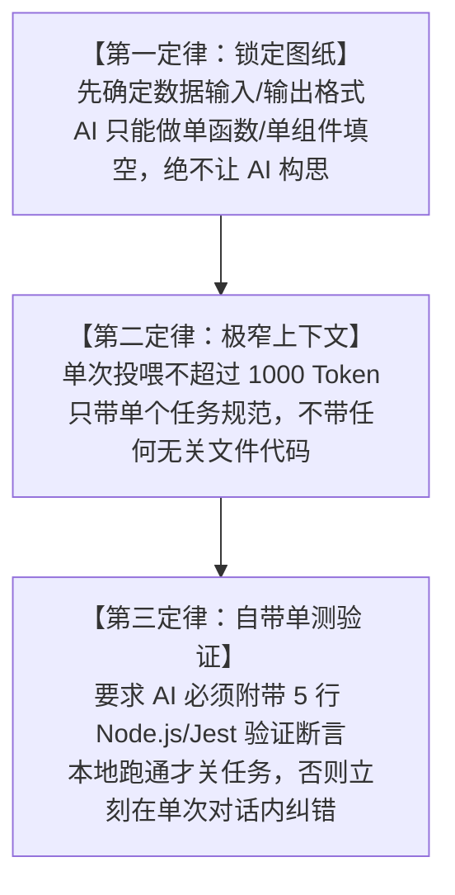
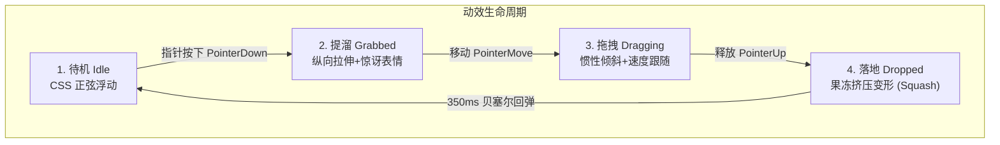

# 班级电子宠物重构全案：极省Token执行路线图、代码逻辑全解、拖拽动效与素材生成指南

> **文档性质**：重构总指挥部白皮书与执行作战指南  
> **适用场景**：新建独立目录使用外部 AI 工具（Codex / Claude / 中转站）进行重构，指导每一分额度都花在刀刃上，坚决杜绝试错与返工。

---

## 目录
1. [中转站额度“零浪费”操作宪章](#一-中转站额度零浪费操作宪章)
2. [重构核心产品与代码逻辑终极明确](#二-重构核心产品与代码逻辑终极明确)
3. [宠物拖拽动效技术方案与物理引擎实现全解](#三-宠物拖拽动效技术方案与物理引擎实现全解)
4. [AI宠物素材生图实战手册与提示词库](#四-ai宠物素材生图实战手册与提示词库)
5. [外部Codex分步投喂提示词库（即插即用纯净版）](#五-外部codex分步投喂提示词库即插即用纯净版)
6. [全流程执行检查清单与时间线](#六-全流程执行检查清单与时间线)

---

## 一、 中转站额度“零浪费”操作宪章

中转站 API 额度昂贵且有调用限制，重构之所以会大量浪费 Token，主要是由于以下三大恶习：
1. **让 AI“自主设计”**：直接给一句空泛的需求，AI 吐出几百行格式不对、思路偏差的代码，消耗成千上万 Token。
2. **反复粘贴报错信息**：一段代码跑不起来，就把几十行报错反复喂给 AI 让它修，陷入无休止的“修一处崩三处”。
3. **全工程上下文打包投喂**：每次把整个项目所有文件全部附上，单次 Prompt 消耗直接拉满。

### 零浪费三定律（必须严格执行）：


---

## 二、 重构核心产品与代码逻辑终极明确

在向外部工具下达任何编码指令前，整个应用的核心业务逻辑必须在脑海中 100% 固化，不再有任何摇摆：

### 1. 账号与数据隔离逻辑：班级空间（Classroom Realm）
- **实体层级**：`学校/年级`（可选元数据） -> `班级 (Classroom)`（顶层物理隔离） -> `学科 (Subjects)` & `学生 (Students)`。
- **本地单机特性**：一个班级对应本地 SQLite 的一套数据空间。教师登录时选择所属班级，或者直接切换班级空间。
- **红线**：严禁出现跨班级学生混杂。所有查询必须强制带有 `class_id` 条件。

### 2. 自定义学科体系与“一生多宠”架构
- **学科自定义**：支持教师在操作台增删改学科（如：语文、数学、英语、科学、美术、体育、劳动、道法等），学科含名称、专属图标、主题色。
- **宠物与学科绑定**：
  - 传统模式：1 个学生只有 1 只宠物（科任老师体验极差，语文老师加分数学老师看不到归属感）。
  - **新架构（必须严格落地）**：1 个学生拥有一个“宠物乐园”，**每个学科对应 1 只独立的学科神兽**！
  - 数据模型关系：
    ```text
    Student (学生) 1 ─── N PetInstance (学科宠物实例)
    PetInstance 包含：
      - id: 主键
      - student_id: 外键 -> Student
      - subject_id: 外键 -> Subject
      - pet_type: 宠物外观类型（如：墨水灵、几何兽、音符精灵等）
      - level: 当前等级 (1 ~ 100)
      - current_exp: 当前经验值
      - max_exp: 当前升下一级所需经验
      - total_awakened: 觉醒唤醒总次数 (历史满级转生数)
      - status: 活跃中 / 觉醒殿堂
    ```

### 3. 动态评分路由机制（Scoring Dispatcher）
- **核心交互**：教师操作台和学生大屏的顶栏，始终显示**“当前上课科目”选择器**（默认可记住上次选中，例如当前是“数学课”）。
- **路由逻辑**：
  - 当教师点击某个学生的“+1分”（课堂积极发言）时，前端系统**自动路由到该学生对应的【数学宠物实例】**进行经验累加。
  - 大屏弹出的升级动效与提示，展示的是该学科的专属宠物。
  - 科任老师无需额外繁琐挑选，一键加分精准入账本学科。

### 4. 王者唤醒机制（满级清零与新蛋认领）
- 当某学科宠物达到 100 级满经验时：
  1. 触发全屏金色“学科王者觉醒”庆典动效；
  2. 记录一次 `total_awakened + 1`，将满级神兽送入学生专属的“荣誉殿堂/神兽阁”；
  3. 系统自动为该学科重新分发一枚“神级进阶宠物蛋”，等级重置为 1 级开启二周目进阶成长；
  4. 学生排行榜不仅比单宠等级，还能比拼**“全科觉醒总神兽数”**，激发学生长久动力。

### 5. 学生卡片双形态设计（满足负责人折叠要求，兼顾大屏直观性）
为彻底解决领导“卡片内容太杂乱必须折叠，但又担心折叠后大屏看不清”的争议，代码中必须实现**两套受控视图模式**，通过配置一键切换：
- **形态 A：折叠手风琴模式（Accordion View，汇报重点）**
  - 卡片顶部：学生头像、姓名、当前上课学科宠物的微缩动态、总分。
  - 折叠面板 1：【当前学科成长】（经验条、等级、近期加减分明细）。
  - 折叠面板 2：【全科宠物矩阵】（九宫格或微缩列表显示语文、数学、英语等其他学科宠物状态）。
  - 折叠面板 3：【装备与徽章】（所获课堂勋章）。
- **形态 B：扁平分块分栏模式（Flat Segmented View，备选评估）**
  - 不折叠，用极其清晰的轻量线框栅格化排列，一屏尽收眼底。

### 6. 多级圆圈快捷菜单路由
- **1级主圆圈**：大屏右下角或选定学生时的浮动圆圈。
- **2级菜单**：展开为【快速表扬】、【快速批评】、【学科切换】、【随机点名】、【课堂计时】。
- **3级菜单**：在【快速表扬】下展开具体分值与行为标签（如：回答正确+1、坐姿端正+1、小组第一+2、创意解法+3）。

---

## 三、 宠物拖拽动效技术方案与物理引擎实现全解

### 1. 为什么不能用游戏引擎？
千万不要让 Codex 引入 Phaser.js、Pixi.js、Three.js 或 Cocos。因为：
1. 占用内存极大，教室内的老旧希沃/鸿合触摸一体机容易直接崩溃或卡顿。
2. 难以与 React/Vue 的 DOM 状态无缝融合，容易引发大量内存泄漏与事件穿透 Bug。
3. 外部 Codex 在写游戏引擎交互时极易消耗巨量 Token 调试渲染循环。

### 2. 最佳方案：纯原生 DOM + CSS 弹簧物理 + 状态帧切换
仅需一个轻巧的 Controller，捕获指针事件（Pointer Events），直接操作 CSS `transform` 与精灵图状态：



### 3. 可直接拿去使用的动效物理控制器代码模板
这段代码是纯 TypeScript，没有任何外部 npm 依赖，性能极高（60fps 稳跑）：

```typescript
// 文件名：src/renderer/components/pet/PetDragPhysics.ts
export type PetVisualState = 'idle' | 'grabbed' | 'dragging' | 'bounce';

export interface DragPhysicsOptions {
  element: HTMLElement;
  onStateChange: (state: PetVisualState) => void;
  onPositionChange?: (x: number, y: number) => void;
}

export class PetDragPhysics {
  private el: HTMLElement;
  private onStateChange: (state: PetVisualState) => void;
  private isDragging = false;
  private startX = 0;
  private startY = 0;
  private lastX = 0;
  private currentX = 0;
  private currentY = 0;
  private vx = 0;

  constructor(options: DragPhysicsOptions) {
    this.el = options.element;
    this.onStateChange = options.onStateChange;
    this.initEvents();
  }

  private initEvents() {
    this.el.style.touchAction = 'none';
    this.el.style.userSelect = 'none';
    this.el.style.cursor = 'grab';

    this.el.addEventListener('pointerdown', this.handlePointerDown);
    window.addEventListener('pointermove', this.handlePointerMove);
    window.addEventListener('pointerup', this.handlePointerUp);
    window.addEventListener('pointercancel', this.handlePointerUp);
  }

  private handlePointerDown = (e: PointerEvent) => {
    this.isDragging = true;
    this.startX = e.clientX - this.currentX;
    this.startY = e.clientY - this.currentY;
    this.lastX = e.clientX;
    this.el.setPointerCapture(e.pointerId);
    this.el.style.cursor = 'grabbing';

    // 提溜拉伸：锚点在顶部，身体竖直拉长
    this.el.style.transformOrigin = 'top center';
    this.el.style.transition = 'transform 0.15s cubic-bezier(0.2, 0.9, 0.3, 1)';
    this.el.style.transform = `translate(${this.currentX}px, ${this.currentY}px) scale(0.92, 1.15)`;
    this.onStateChange('grabbed');
  };

  private handlePointerMove = (e: PointerEvent) => {
    if (!this.isDragging) return;
    this.currentX = e.clientX - this.startX;
    this.currentY = e.clientY - this.startY;

    // 计算水平速度以计算倾斜摆动角度
    this.vx = e.clientX - this.lastX;
    this.lastX = e.clientX;
    const tilt = Math.max(-16, Math.min(16, this.vx * 0.75));

    this.el.style.transition = 'none'; // 拖拽中必须无过渡，保证跟手
    this.el.style.transform = `translate(${this.currentX}px, ${this.currentY}px) scale(0.95, 1.08) rotate(${tilt}deg)`;
    this.onStateChange('dragging');
  };

  private handlePointerUp = () => {
    if (!this.isDragging) return;
    this.isDragging = false;
    this.el.style.cursor = 'grab';
    this.onStateChange('bounce');

    // 释放落地：果冻挤压 (Squash & Stretch) 阻尼弹性动画
    this.el.style.transformOrigin = 'bottom center';
    this.el.style.transition = 'transform 0.45s cubic-bezier(0.34, 1.56, 0.64, 1)';
    // 先压扁，然后回弹
    this.el.style.transform = `translate(${this.currentX}px, ${this.currentY}px) scale(1.18, 0.82) rotate(0deg)`;

    setTimeout(() => {
      this.el.style.transform = `translate(${this.currentX}px, ${this.currentY}px) scale(1, 1)`;
      this.onStateChange('idle');
    }, 200);
  };

  public destroy() {
    this.el.removeEventListener('pointerdown', this.handlePointerDown);
    window.removeEventListener('pointermove', this.handlePointerMove);
    window.removeEventListener('pointerup', this.handlePointerUp);
    window.removeEventListener('pointercancel', this.handlePointerUp);
  }
}
```

---

## 四、 AI宠物素材生图实战手册与提示词库

### 1. 为什么你的宠物素材老是画风崩坏？
因为你每次给 AI 不同的 Prompt 去单独画一张动作图。AI 每次生成的脸型、颜色、线条粗细都无法保持一致。

### 2. 核心武器：Sprite Sheet（多姿态动作精灵图）
利用 **“同图四格画（4-Pose Sheet）”**，强制 AI 在一张图里输出该角色的 4 种状态。

#### 通用生图模板（直接复制到 Midjourney、Stable Diffusion、即梦、豆包中）：
```text
Game character sprite sheet, cute fantasy mascot [替换主体，如：chubby baby dragon with small soft horns], showing 4 different action poses on a pure clean white background:
1. [Idle: front view, floating gently, sweet happy smiling face, closed mouth, peaceful eyes]
2. [Picked-up: lifted by scruff of neck, suspended in mid-air, elongated stretchy body, cute surprised open eyes, tiny dangling feet]
3. [Dragged: tilted back against wind, energetic funny face, dynamic stretch]
4. [Bounce impact: squished flat like soft mochi dumpling on ground, squashed round body, sparkling joyful eyes, blushing cheeks]
Flat cartoon vector art style, thick clean bold outlines, simple soft cel-shading, vibrant cheerful colors, 2D mobile game asset sheet, pure white background, no shadow, ultra high resolution --ar 16:9 --v 6.0
```

#### 学科专属宠物提示词示例：
| 学科 | 推荐宠物形象 | 核心特征关键词 | 替换上方的主体描述词 |
| :--- | :--- | :--- | :--- |
| **语文** | 墨水灵 (Ink Droplet) | 中国水墨风水滴、戴学士小帽、翻卷书页 | `a magical Chinese ink droplet creature wearing a tiny ancient scholar cap` |
| **数学** | 几何小怪 (Geometry Slime) | 晶体小方块、三角尺发卡、科技感眼睛 | `a cute geometric crystal slime creature with glowing mathematical symbols` |
| **英语** | 字母鹦鹉 (Letter Parrot) | 胖乎乎羽毛、叼着字母A、活泼英伦风 | `a chubby colorful baby parrot wearing a tiny bowtie and holding an alphabet letter` |
| **科学** | 齿轮齿轮兽 (Gear Bot) | 发条发光机器人、灯泡触角、呆萌转动 | `a friendly tiny steam-powered robot creature with a glowing lightbulb antenna` |
| **美术** | 调色盘猫咪 (Palette Kitty) | 爪子沾着彩墨、尾巴像画笔、毛茸茸 | `a fluffy white kitten with a paint-brush tail and colorful paint splatter spots` |
| **体育** | 闪电飞鼠 (Thunder Squirrel)| 运动头带、握着金牌、蓬松大尾巴 | `an energetic flying squirrel wearing a tiny red sports headband` |

### 3. 素材切图与极速落地流程：
1. **生成**：在生图工具中跑出满意的一组图；
2. **免扣图工具**：使用免费抠图网站（如 remove.bg 或即时设计抠图插件）一键把纯白背景变透明；
3. **切图**：裁切成 4 个独立 PNG 文件存入项目目录：
   - `assets/pets/math/idle.png`
   - `assets/pets/math/grabbed.png`
   - `assets/pets/math/dragging.png`
   - `assets/pets/math/bounce.png`
4. **绑定**：将上面的 `PetVisualState` 与这 4 张图片直接映射即可！

---

## 五、 外部Codex分步投喂提示词库（即插即用纯净版）

**操作指南**：在新的重构工程中，**每一次只把下面一个框的内容复制给 Codex**。Codex 输出后，你在本地运行它自带的测试代码，测试通过再发下一个任务。

### 【任务 T1】：纯多学科 SQLite 数据表与 DAO（约消耗 1200 Token）
```markdown
【任务编号】：T1-Database-MultiSubjectPet
【角色】：你是一名资深 SQLite + TypeScript 架构师。
【目标】：请在 src/main/db/ 目录下编写 database.ts 与 petDao.ts，仅实现纯数据层逻辑，禁止包含任何界面代码。
【业务数据契约】：
1. 表 classes: id, name, created_at
2. 表 subjects: id, class_id, name (如'语文','数学'), icon, color
3. 表 students: id, class_id, name, student_no
4. 表 pet_instances: 
   - id, student_id, subject_id, pet_type, level(默认1), exp(默认0), max_exp(默认100), total_awakened(默认0)
   - 联合唯一索引: UNIQUE(student_id, subject_id)
【输出要求】：
1. 使用 better-sqlite3 或 sqlite3 参数化预编译查询，绝对禁止拼接 SQL 字符串。
2. 包含 CRUD 方法：
   - getStudentPets(studentId: string): 获取该学生所有学科宠物
   - getStudentSubjectPet(studentId: string, subjectId: string): 获取指定学科宠物
   - addPetExp(petInstanceId: string, expDelta: number): 增加经验并返回更新后实例
3. 必须在文件末尾提供一个 runSelfTest() 函数，直接在内存数据库 (:memory:) 插入班级、学科、学生与宠物并断言查询结果。
```

### 【任务 T2】：纯函数加分路由与满级唤醒算法（约消耗 800 Token）
```markdown
【任务编号】：T2-Engine-ScoringAndAwaken
【角色】：纯算法逻辑工程师。
【目标】：编写 src/common/scoringEngine.ts，纯 TypeScript 函数，无任何 UI 依赖。
【规则说明】：
1. 升级公式：max_exp = level * 100。
2. 当 expDelta 为正时：
   - 循环计算是否升级：若 current_exp >= max_exp，则 level += 1，扣除 max_exp，更新下一个 max_exp；
   - 满级判定：当 level >= 100 时，触发满级唤醒：total_awakened += 1，level 重置为 1，exp 清零，返回 isAwakened: true。
3. 当 expDelta 为负时：
   - 扣除经验，最低不可低于当前等级 0 经验（等级不降级，或配置可降级）。
【输出要求】：
1. 导出 calculateExpProgression(currentLevel, currentExp, deltaExp): CalcResult
2. 附带纯 Node.js 的断言测试用例，覆盖：正常加分升级、连续升多级、满级唤醒触发三种场景。
```

### 【任务 T3】：学生卡片双形态组件（折叠+平铺）（约消耗 1500 Token）
```markdown
【任务编号】：T3-Component-StudentCardDualView
【角色】：高级 React/Vue 前端工程师。
【目标】：实现学生详情展示组件 StudentCardModal，要求支持 layoutMode="accordion"（折叠）和 layoutMode="flat"（平铺）两种形态。
【展示字段】：
1. 学生基础信息：头像、姓名、学号、总觉醒神兽徽章数；
2. 当前焦点学科宠物：形象预览、当前等级、经验进度条；
3. 全科宠物矩阵：横向排布其他各科宠物的微缩状态；
4. 历史评分记录列表。
【折叠模式要求】：
- 使用标准 Accordion 交互，包含【当前学科状态】、【其他学科矩阵】、【课堂表现明细】三个可独立展开收起的面板。
- 保证无样式冗余，使用语义化 HTML 和清晰的 CSS Modules/Tailwind 结构，禁止使用过度花哨的拟物化拟态。
```

### 【任务 T4】：大屏右下角多级圆圈快捷菜单（约消耗 1000 Token）
```markdown
【任务编号】：T4-Component-RadialShortcutMenu
【角色】：前端交互架构师。
【目标】：编写大屏快捷圆圈组件 RadialShortcutMenu。
【层级逻辑】：
- 1级圆圈（中心浮动按钮）：点击展开/收起2级菜单；
- 2级圆圈组（围绕中心呈环形展开）：
  - 选项A：【快速表扬】
  - 选项B：【快速待改进】
  - 选项C：【切换上课学科】
  - 选项D：【随机点名抽签】
- 3级圆圈组（点击【快速表扬】后，原位置平滑切换为表扬细项）：
  - +1 积极发言、+1 坐姿端正、+2 合作探究、+3 卓越解法
【要求】：
1. 纯受控状态机实现，输出选中的事件 (onSelectAction(actionType, value))；
2. 动画使用纯 CSS transform 和 transition 实现，禁止引入沉重第三方动画库。
```

### 【任务 T5】：宠物拖拽交互与状态帧切换组件（约消耗 1000 Token）
```markdown
【任务编号】：T5-Component-DraggablePet
【角色】：前端交互动效工程师。
【目标】：编写 DraggablePetView 组件，将前面定义的物理控制器集成到宠物渲染中。
【属性输入 (Props)】：
- petName: string
- imageMap: { idle: string; grabbed: string; dragging: string; bounce: string; }
- onClick?: () => void
【功能要求】：
1. 挂载时绑定 Pointer 事件，拖拽时有提溜拉伸、惯性摇摆、落地果冻弹跳；
2. 根据物理控制器的状态回调，动态切换 img src 为对应的贴图（idle/grabbed/dragging/bounce）；
3. 支持点击穿透判定：轻点（位移 < 5px）触发 onClick，长拖拽只触发物理拖动不触发 onClick。
```

---

## 六、 全流程执行检查清单与时间线

你可以打印或对照以下清单，一步一个脚印推进，绝不慌乱：

- [ ] **第 1 步：素材先行（0 代码，今天完成）**
  - 使用本文第四章的提示词，生成 1~2 组带有 4 态的宠物 Sprite Sheet 图片；
  - 抠图并裁切为透明 PNG 备用。
- [ ] **第 2 步：创建纯净新目录（0 Token）**
  - 在电脑新建空白文件夹（如 `class-pet-reborn`）；
  - `npm init -y` 初始化，安装必要运行环境。
- [ ] **第 3 步：执行任务 T1（只消耗 ~1200 Token）**
  - 复制任务 T1 投喂给 Codex；
  - 本地运行内置测试代码，验证 SQLite 数据库读写正常。
- [ ] **第 4 步：执行任务 T2（只消耗 ~800 Token）**
  - 复制任务 T2 投喂给 Codex；
  - 本地验证 100 级满级唤醒转生算法跑通。
- [ ] **第 5 步：组装任务 T3 & T5（展示卡片与宠物动效）**
  - 将生成的宠物透明 PNG 接入 T5 动效，在浏览器中测试拖拽手感；
  - 接入 T3 学生卡片，向工作室负责人演示折叠与平铺双形态效果。
- [ ] **第 6 步：比对历史 32 条红线**
  - 对照先前沉淀的《历史踩坑与必须严格规避的Bug红线清单》，逐一做验收打勾。
