# 班级宠物系统 (Class Pet)：儿童绘本风格 UI 调研与 48 小时极速交付全景指南

> **适用场景**：零基础/非专业开发者的独立开发者、希沃白板/班级大屏一体机交互、周三/周四（48小时内）紧急上线交付。  
> **核心原则**：温润护眼、绘本纸感、做减法、零认知门槛、原地闭环交互。

---

## 一、 20260918 录音现场原文精准还原

### 1. 证据链与文件定位
*   **录音原始文件**：`D:\Desk\ALL Vibe\new-class-pet\20260918\系统优化.m4a`
*   **校对准确逐字稿文件**：`D:\Desk\ALL Vibe\new-class-pet\20260918\系统优化_校对准确版.docx`
*   **系统文本转储**：`D:\Desk\ALL Vibe\new-class-pet\scratch\dump_20260918.txt`
*   **时间戳定位**：`00:00 - 00:41`

### 2. 逐字逐句对话还原（一字不漏）

```text
[00:00] 说话人 1（工作室负责人）：不用，不用白白耗掉那么多 token 嘛。先确认，这一步先确认。确认完之后咱们看看，就定这种风格。
[00:08] 说话人 2（开发者）：嗯。就是绘本，绘本这一块先就是网上找一些，然后呃就是定下。
[00:14] 说话人 1（工作室负责人）：呃，就是...呃，第一点是啥？第一点是前端界面展示。前端界面展示要么就尽量做绘本，然后整体是以暖色调为主，保护眼睛。
[00:24] 说话人 2（开发者）：OK。
[00:25] 说话人 1（工作室负责人）：第二，如果绘本风格真是难做，那就选其他风格。但是选其他风格的话，先给我确认一下。这样的话不就不用你一股脑做到最后，到时候又因为这个问题，然后还重新做一遍，这样的话浪费 token，OK 吧？
[00:41] 说话人 2（开发者）：OK。
```

### 3. 为什么负责人反复强调“暖色调护眼”和“极简减法”？（关联实测痛点）
在此次录音的后续实操复测中，负责人明确指出了原有系统的致命硬伤，这些是指引我们重构的最高行动纲领：
1.  **漫游指引文字密麻（03:33 & 08:26）**：
    > *“我说实话这个东西你看就是字又比较多，然后又比较小。颜色又比较那啥……兰老师看到会想，我还不如直接打个电话给刘恺龙。打个电话都方便啊，问这么长，脑壳都开了。我敢保证没有一个人会看的！”*  
    > ➔ **决策落地**：**彻底删掉新手漫游指引弹窗**，零文字说明，界面控件大而直观。
2.  **经验值设置像王者荣耀（13:47）**：
    > *“经验设置说实话太复杂了，我一眼都不会看！就好像我打王者荣耀一样，那些技能介绍我一眼都不会看，我还不如直接进去打一把再说。”*  
    > ➔ **决策落地**：**砍掉繁复的计算公式和嵌套设置**，回退到首版极简数字输入。
3.  **互动升级严重串人 Bug（00:47）**：
    > 给小红加分触发升级，弹窗出来的形象和数据居然变成了小明。  
    > ➔ **决策落地**：所有卡片弹窗必须严格单向绑定当前激活的学生 ID，杜绝全局脏状态。
4.  **“可孵化”必须原地闭环（现场痛点）**：
    > 原版在卡片内经验喂满了，不能直接点孵化，必须关闭弹窗退回大屏再去找人。  
    > ➔ **决策落地**：卡片弹窗内直接就地触发“破壳孵化”大按钮。
5.  **烟花高光庆祝丢失（现场痛点）**：
    > 原版升级时没有任何仪式感。  
    > ➔ **决策落地**：恢复底部升腾彩色纸屑/烟花粒子动效与音效。

---

## 二、 儿童绘本风格全景调研（中国、欧洲、美国与大奖案例）

儿童绘本风格（Children's Picture Book / Storybook UI）的精髓在于：**温润纸感、柔和包容、画卷叙事、消除冰冷机械感**。它绝不是低幼涂鸦，而是具有极高艺术水准与舒适度的界面语言。

### 1. 中国标杆：国风绘本与现代少儿互动
*   **故宫博物院少儿数字互动（《你好呀！故宫》《哇！故宫二十四节气》）**
    *   **核心特色**：以中国传统熟宣纸、米浆纸肌理为背景（暖米白/浅麦黄），融入二十四节气自然色彩。
    *   **界面形态**：放弃传统矩形后台表格，把学生/功能模块做成“百宝阁小木格”或“画卷卡片”，神兽圆润拟人，绝无刺眼蓝白高光。
*   **洪恩系列（洪恩识字 / 洪恩小画家 Web & App）**
    *   **核心特色**：国内少儿界面天花板。全场景绘本包装，微拟物手绘材质（小木牌卡片、手揉纸边框、泥塑质感），色块饱满柔和，边角全部经过大圆角（Border Radius ≥ 24px）钝化。
    *   **交互特征**：操作按钮像“童话小镇里的木招牌”，点击伴随轻微果冻回弹。
*   **叫叫阅读（Jiaojiao Reading）& 斑马（Zebra）**
    *   **核心特色**：严格遵循 60-25-10 护眼暖色配比，页面犹如一本翻开的硬壳立体书，字号大，层级少。

### 2. 欧洲标杆：北欧极简童趣与英式手绘
*   **Toca Boca（瑞典，全球儿童数字产品设计天花板）**
    *   **设计哲学**：“数字玩具”而非“办公软件”。彻底抛弃传统树形导航与繁杂设置菜单。
    *   **色彩与形态**：马卡龙低饱和暖色系，高辨识度几何软化轮廓，触控靶心巨大（80px+），非常适合一体机触控。
*   **Oliver Jeffers 官方交互网站（英国/爱尔兰，《不可思议的吃书男孩》作者）**
    *   **核心特色**：充满诗意的手写体、手绘水彩小人和暖象牙白底色（#FDFBF7），绝无工业流水线模板感。
*   **Quentin Blake Centre（英国，罗尔德·达尔御用插画师平台）**
    *   **核心特色**：轻盈自由的钢笔线条感，飞溅的温暖水彩，自然、奔放而亲切。
*   **Moomin 官方数字互动（芬兰姆明）**
    *   **核心特色**：北欧森林绘本系，大地色、苔藓柔绿与暖落日橘，自然质朴。

### 3. 美国标杆 & 国际顶级设计大奖（Awwwards / FWA 获奖网站）
*   **《My Little Storybook》（by Lusion，荣获 Awwwards SOTD / FWA 每日最佳）**
    *   **获奖核心**：将立体的绘本翻页机制（Pop-up Book）搬上网页，模拟日光在纸张上的柔和漫反射光效。
    *   **界面语言**：每个卡片就像一张插在纸质相框里的手绘插画卡片。
*   **Khan Academy Kids（可汗学院儿童版，全美儿童教育交互教科书）**
    *   **界面规范**：护眼奶油底色 + 大圆角卡片 + 森林动物伙伴。界面极度干净，绝无多余参数干扰，正向强化反馈极致（完成任务立刻有彩色纸屑/五彩星光喷洒）。
*   **Eric Carle (《好饿的毛毛虫》作者) 官方数字体验**
    *   **核心特色**：手绘拼贴画（Collage）与手工剪纸纹理，色彩丰富但质感纯朴。

---

## 三、 色彩与字体红黑榜（明确准则）

### 1. 色彩规范（严格 60-25-10-5 黄金法则）

```
[ 60% 纸张暖底色 ]  ─────────>  #FAF6EE / #FFFDF5 (奶油宣纸白，杜绝冷白)
[ 25% 场景辅助色 ]  ─────────>  #FF9F45 (暖橙) / #78A083 (草木绿) / #F3C68F (浅麦黄)
[ 10% 交互点缀色 ]  ─────────>  #FF6B6B (草莓珊瑚红 - 升级/破壳) / #4D96FF (晴空蓝)
[  5% 文本中性色 ]  ─────────>  #3A3027 (浓浓咖啡褐，杜绝纯黑死黑)
```

| 角色与占比 | 推荐要用的颜色（绿榜 👍） | 严禁使用的颜色（红榜 ❌） | 为什么这样选？（痛点分析） |
| :--- | :--- | :--- | :--- |
| **大面积底色 (60%)** | **奶油白 `#FAF6EE`**<br>**暖宣纸色 `#FFFDF5`**<br>**护眼浅米褐 `#F7F1E5`** | **纯白 `#FFFFFF`**<br>**冷系统灰 `#F3F4F6`** | 教室希沃一体机或投影发光强，纯白大面积亮屏极度刺眼发晕；冷灰会秒变冷漠的钉钉后台。 |
| **主文本与边线 (5%)** | **暖咖啡深褐 `#3A3027`**<br>**浓墨暖黑 `#2D241E`** | **死黑 `#000000`** | 纯黑在浅色纸质底上对比度生硬且割裂，深咖啡褐自带绘本印刷墨水温润感。 |
| **交互与按钮 (10%)** | **阳光暖橙 `#FF9F45`**<br>**珊瑚草莓红 `#FF6B6B`**<br>**草木绿 `#78A083`** | **荧光绿 `#00FF00`**<br>**刺眼纯青 `#00FFFF`**<br>**高亮品红 `#FF00FF`** | 极度饱和的霓虹色是视觉灾难，严重伤眼且显得廉价土气。 |
| **次要信息文本** | **浅暖褐 `#736357`**<br>**温暖泥灰 `#8C7D73`** | **冷灰 `#9CA3AF`** | 全局维持 3500K-4500K 暖光感，避免混入冷色温。 |

---

### 2. 字体规范（大屏大字护眼规范）

| 场景 | 推荐要用的字体（绿榜 👍） | 严禁使用的字体（红榜 ❌） | 排版关键参数 |
| :--- | :--- | :--- | :--- |
| **大标题 / 班级名** | **站酷快乐体**（开源商用）<br>**优设标题圆**（免费商用）<br>**悠哉体**（手绘感） | **宋体 / 细明体**<br>**行楷 / 草书** | 尖锐衬线像试卷冷硬有刺痛感；草书儿童不认识。字重必须 ExtraBold。 |
| **正文与卡片姓名** | **幼圆**（Windows 电脑 100% 自带，**免安装零门槛**！）<br>**HarmonyOS Sans SC Rounded** | **Times New Roman**<br>**普通中易宋体**<br>**极细黑体 (Light/Thin)** | 细字体在大屏投影后排完全看不见！幼圆圆润亲和、零配置成本，开发最快！ |
| **数字与经验值** | **Fredoka** / **Quicksand** / **Nunito**（圆润可爱） | **Courier** (代码等宽)<br>**Impact** (狭窄压抑) | 数字字号建议 24px+，像积木一样可爱。 |

*   **排版黄金参数**：
    *   行高 (`line-height`)：`1.6 ~ 1.8`
    *   字间距 (`letter-spacing`)：`0.04em`（略微加宽，透气不拥挤）
    *   大屏正文字号：不低于 `22px - 26px`

---

## 四、 AI 绘本宠物素材统一 Prompt 规范（开箱即用）

### 1. 绘本通用咒语骨架
> **核心风格词**：  
> `治愈系儿童绘本插画，水彩与蜡笔手绘质感，温润纸张肌理，大头小身Q版圆润，温暖柔和日光感，柔和轮廓线，纯白色/单色干净背景，主体居中，无杂物，无阴影，无任何文字，无水印，高清大师级绘本立绘`  
> *(英文版 Midjourney 模版)*:  
> `children's picture book illustration of a cute [animal], soft gouache and crayon texture, warm pastel color palette, gentle paper cut edge, simple rounded shapes, high readability, isolated on white background, masterpiece --no complex background, text, watermark --v 6.0`

### 2. 四大萌宠·测试样例（复制直接生图）：
1.  **神秘宠物蛋 (Lv.0)**：
    > 治愈系儿童绘本插画，一枚圆滚滚的温暖灵兽蛋，蛋壳上有柔和手绘蜡笔星星和暖金螺旋纹，顶端有微光小裂纹，水彩手绘质感，柔和暖色调，纯白背景，主体居中，无地面阴影，无文字，无水印
2.  **暖暖小奶猫 (Lv.1)**：
    > 治愈系儿童绘本插画，一只刚破壳的浅米黄色短毛小奶猫，大大的水灵灵深栗色大眼睛，圆圆的小包子脸和粉嫩腮红，大头小身憨态可掬，水彩蜡笔质感，暖色调，纯白背景，居中，无地面阴影，无文字
3.  **圆耳布丁仓鼠 (Lv.1)**：
    > 治愈系儿童绘本插画，一只圆滚滚像小面团一样的金黄色布丁小仓鼠，小肉爪捧着一颗小松子，圆圆的小耳朵，温和柔润的蜡笔轮廓，水彩质感，暖色调，纯白背景，居中，无文字
4.  **垂耳豆豆犬 (Lv.1)**：
    > 治愈系儿童绘本插画，一只软萌垂耳小幼犬，米白加浅咖啡斑纹，黑溜溜圆眼睛，吐着一点点粉舌头，坐在地上，温暖水彩绘本风格，纯白背景，居中，无文字

---

## 五、 大厂模式 vs 个人开发者 48 小时极速交付策略

### 1. 对比分析
*   **大厂正规流程（耗时 2~3 个月）**：  
    用户研究员调研 ➔ 插画师逐帧绘制 Spine 骨骼动画 ➔ 动效师导出 Lottie ➔ UI 建立 Figma Design Tokens ➔ 前端组件库封装 ➔ 后端接口鉴权 ➔ 自动化测试与 QA。——**你只有 48 小时，走这条路必死无疑。**
*   **个人开发者极速生存模式（48 小时保命上线）**：  
    **做减法 + 绘本卡片原子化 + 纯净单向数据流 + 纯 CSS 动效**。

### 2. 48 小时实操排期与执行步骤

```mermaid
gantt
    title 48小时极速交付排期
    dateFormat  HH
    axisFormat  %H小时
    section 资产与规划
    AI生成绘本素材(蛋+4种宠物)     :a1, 00, 2h
    新文件夹建立纯净项目脚手架      :a2, after a1, 1h
    section 核心UI搭建
    顶部木质导航与48人绘本画卷网格  :b1, after a2, 3h
    原地学生互动弹窗(加分/破壳)    :b2, after b1, 3h
    纯CSS五彩纸屑庆祝升级特效      :b3, after b2, 2h
    section 联调与交付
    修复串人问题与数据持久化        :c1, after b3, 3h
    一体机大屏触控走查与打包交付    :c2, after c1, 2h
```



#### Step 1: 资产生成（耗时：1-2 小时）
用上方 Prompt 在即梦或 Midjourney 生成 1 颗蛋和 4 只核心萌宠，抠出透明底 PNG，放入 `assets/pets/`。

#### Step 2: 在新文件夹开辟全新干净工程（耗时：1 小时）
建议路径：`D:\Desk\ALL Vibe\class-pet-storybook-v2`。  
**彻底放弃老代码中的物理碰撞引擎和深层嵌套模态框**，采用单一状态树，每个学生卡片状态严格隔离：
```javascript
// 简单清晰的单一状态模型
const state = {
  currentSubject: "语文",
  activeStudentId: null, // 当前打开弹窗的学生ID，严格隔离，防止串人！
  students: [
    { id: 1, name: "陈小明", petType: "cat", level: 1, exp: 20, maxExp: 100 },
    // ...
  ]
};
```

#### Step 3: 绘本三段式固定布局（耗时：3 小时）
1.  **顶部木牌招牌**：暖木色小条，放置班级名（`三年二班 快乐小宠`）、科目切换按钮、一键点名。
2.  **大屏画卷网格**：`grid-cols-6` 或 `grid-cols-8`，自适应摆放 48 个学生卡片。
    - 卡片背景：`#FFFDF5`，边框 `2px solid #EADBCE`，圆角 `24px`。
    - 卡片元素：大头宠物图、学生姓名（幼圆 22px 加粗）、粗粗的暖橙色经验条。
3.  **原地弹出交互卡片**：
    - 点击卡片，直接在屏幕中央弹起一张硬壳绘本大卡片。
    - 提供【喂食 +5】【认真听讲 +10】【积极发言 +10】大按钮（触控靶心 ≥ 64px）。
    - 当经验值达到上限时，原地直接浮现闪烁的【✨ 点击破壳升级！】按钮，**原地完成孵化，绝不关闭弹窗重回大屏！**

#### Step 4: 纯 CSS 烟花彩纸动效（耗时：30 分钟）
无需引入庞大的第三方粒子库，仅需 15 行纯 CSS 关键帧动画：
```css
@keyframes confetti-rise {
  0% { transform: translateY(60px) scale(0.5); opacity: 0; }
  50% { opacity: 1; }
  100% { transform: translateY(-120px) rotate(360deg) scale(1.2); opacity: 0; }
}
.confetti-piece {
  position: absolute;
  width: 14px;
  height: 14px;
  border-radius: 4px;
  animation: confetti-rise 1.2s ease-out forwards;
}
```

#### Step 5: 坚决落实“减法原则”
- 彻底**不写**漫游新手引导代码。
- 经验设置页面只保留一个简单数字框（如：每 100 经验自动升阶）。
- 绝不搞复杂的自由物理碰撞拖拽，踏踏实实用整齐排列的自适应网格。

---

*文档已保存至本地：`D:\Desk\ALL Vibe\new-class-pet\儿童绘本风格UI重构与48小时极速交付全景指南.md`，可随时离线查看。*
